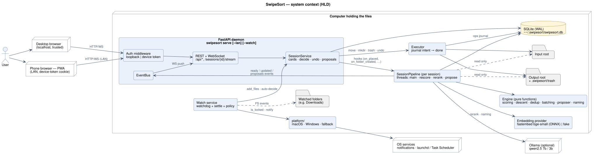

# SwipeSort

[](https://github.com/adityam789/swipesort/actions/workflows/ci.yml)
[](LICENSE)


**Local-first, AI-assisted file sorter.** Point it at a messy folder and an output tree. Each file becomes a card, and you fling it toward its destination: swipe on a phone, drag or use arrow keys on a desktop. Everything runs on your machine. Files never leave it, and every move can be undone.



## Features

- **Suggestions you can trust:**
  - Each file is scored against your existing folders using several signals: embedding centroid, folder profile, nearest neighbours, and metadata priors.
  - Scores are sorted into tiers: **Confirm**, **Choices** and **Inbox**.
  - An optional local LLM double-checks the ranking and explains each suggestion in one sentence.
- **Deep trees:** files descend into a subfolder only while the model is confident, otherwise they stop at that level's `_Inbox` ("probably somewhere in `Work/PayPal/`").
- **Duplicates:** finds exact copies, near-duplicate images (pHash/dHash), near-duplicate text (MinHash) and versions (`_v2`, `final`), and shows them before everything else.
- **New folders:**
  - Files that fit nowhere are grouped into a "Create `Work/Onboarding/` for these 5 files?" card.
  - An empty output folder gets a whole proposed structure.
- **Never waits on ML:** a background scheduler keeps 15+ cards ready ahead of you, and swiping updates instantly.
- **Phone support:** the daemon serves an installable web app (PWA). Pair a phone over your LAN with a QR code and sort from the couch.
- **Watch mode:** watches folders such as Downloads. Confident files are sorted automatically, and the rest wait as cards. Every automatic move is undoable from a notification or the app.
- **Safe by construction:**
  - Every filesystem change is journaled (intent → done), and undo is unlimited.
  - "Trash" is a quarantine folder. The only permanent delete is an explicit `purge`.
  - The daemon never follows symlinks and never touches anything outside the folders you chose.

## Quick start

Prerequisites: Python 3.12 with [uv](https://docs.astral.sh/uv/), and Node 20+. [Ollama](https://ollama.com) is optional and adds LLM reranking and folder naming.

```bash
git clone https://github.com/adityam789/swipesort.git && cd swipesort
(cd frontend && npm ci && npm run build)        # the daemon serves the built UI
cd backend && uv sync
uv run swipesort serve                          # → http://127.0.0.1:8765
```

Open the URL, then choose an input folder and an output folder. The embedding model (`BAAI/bge-small-en-v1.5`, about 130 MB) downloads on first use. For LLM features:

```bash
ollama pull qwen2.5:7b-instruct                 # or qwen2.5:3b-instruct on smaller machines
```

| Command | What it does |
|---|---|
| `swipesort serve [--lan] [--watch] [--port N]` | Starts the daemon. `--lan` allows paired phones; `--watch` starts the folder watchers. |
| `swipesort pair` | Prints a pairing QR code for a running daemon. |
| `swipesort agent install \| uninstall \| status` | Starts the daemon at login (launchd on macOS, Task Scheduler on Windows). |
| `swipesort purge <session> [--older-than-days N]` | Permanently deletes quarantined trash. This is the only hard delete. |

## How it works

```
scan → fingerprint → extract → dedup → embed → score + descent → READY card
                                                     ↘ LLM rerank · folder proposals (background)
```

Every stage is cached by content hash. Creating a folder or placing a file triggers a cheap re-score of the pending cards, using vector math only.

- [High-level design](docs/architecture/HLD.md): components, file lifecycle, threads.
- [Low-level design](docs/architecture/LLD.md): lookahead scheduler, scoring, descent, proposals, cold start, executor, watch mode, pairing.
- [SPEC.md](SPEC.md): the product and technical specification.

## Configuration

Defaults live in `backend/swipesort/config.py`. Override them in `~/.swipesort/config.toml`:

```toml
[tiers]     confirm = 0.90  choices = 0.60  descend = 0.75
[models]    provider = "local"  llm = "qwen2.5:7b-instruct"
[llm]       provider = "ollama"            # ollama | llamacpp | none
[watch]     folders = ["~/Downloads"]  auto_move_threshold = 0.97
[server]    port = 8765
```

All data lives in `~/.swipesort/` (or `$SWIPESORT_HOME`): the SQLite state and caches, logs, and the model cache.

## Development

```bash
cd backend  && uv run pytest && uv run mypy swipesort && uv run ruff check .
cd frontend && npm test -- --run && npx tsc -b && npx oxlint
cd backend  && uv run swipesort serve --dev     # API with reload; run `npm run dev` in frontend/
```

- Tests run without any model, using a deterministic fake embedding provider.
- `backend/tests/fixtures/generate_corpus.py` builds a synthetic corpus with ground truth (invoices, receipts, resumes, lectures, photos, code, seeded duplicates and misleading names) that every milestone is measured against.
- Evaluation scripts are in `eval/`.
- CI runs the full matrix on **macOS and Windows**.

See [CONTRIBUTING.md](CONTRIBUTING.md).

## Status

Version 1.0 completes milestones M0–M7 of the [spec](SPEC.md#14-milestones-build-in-this-order-each-must-pass-its-acceptance-check):

| | Milestone | Acceptance result |
|---|---|---|
| M0 | Skeleton: executor, journal, undo | Undoing all 50 moves restores the original tree, checked by checksum |
| M1 | Basic AI | top-1 ≈ 83 %, top-3 ≈ 99 % on the hard corpus; next card in 17 ms |
| M2 | Dedup | 100 % exact, 100 % near-duplicate, 0 false exact matches |
| M3 | Lookahead | buffer stays ≥ 15 READY cards at 1 card/s on 1k files |
| M4 | Hierarchy + LLM | nested corpus: 88.6 % correct path with the local model + LLM |
| M5 | New folders | cold start: 7–8 of 8 hidden categories rediscovered, 100 % leaf purity |
| M6 | Mobile | full session completed from a phone over LAN |
| M7 | Watch mode | 16 of 20 files auto-sorted in < 1 s after the download finished; all undoable |

Future work is listed under [Future enhancements](SPEC.md#19-future-enhancements). It includes M8 learning and calibration, dry-run export, Linux, and a native app.

## Security

The daemon listens on localhost only, unless you start it with `--lan`. Phones need a one-time QR pairing, and each device token can be revoked. See [SECURITY.md](SECURITY.md) to report a vulnerability.

## License

[MIT](LICENSE)
