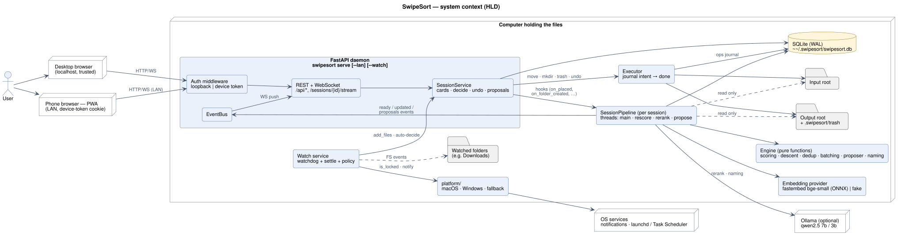
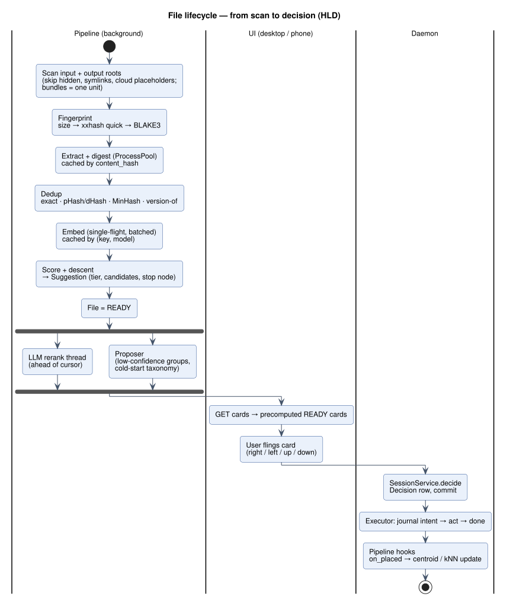

# SwipeSort — High-Level Design

Diagram sources are in `diagrams/*.puml` and the rendered images in `diagrams/*.svg|png`.
Re-render with `plantuml -tsvg -tpng docs/architecture/diagrams/*.puml`.
For using the app see the [user guide](../user-guide.md); for milestones see the [roadmap](../ROADMAP.md).

## 1. System context

| Part | Responsibility | Code |
|---|---|---|
| Daemon | FastAPI + uvicorn process on the machine that holds the files. It is the only thing that reads or writes them. | `main.py`, `cli.py` |
| Auth middleware | Loopback is trusted. Any other client needs a device token, issued through QR pairing. | `api/pairing.py`, `net.py` |
| SessionService | Builds cards, applies decisions and undo, handles proposals. Commits the DB before every executor call. | `api/service.py` |
| SessionPipeline | Per-session background work: scan, extract, dedup, embed, score. Runs 4 threads. | `pipeline/worker.py` |
| Engine | Pure functions over arrays and rows: scoring, descent, dedup, batching, proposer, naming. | `engine/*` |
| Executor | The only code that mutates the filesystem. Journals each op as intent → done; undo runs from the journal. | `exec/executor.py` |
| Watch service | watchdog events → settle → incremental pipeline → auto-move or pending card. | `watch/*` |
| platform/ | Everything OS-specific: locks, notifications, trash, background agent, OCR. | `platform/*` |
| SQLite (WAL) | State and caches. Extraction, features and embeddings are keyed by content hash. | `db/*` |
| Models | Embeddings in-process (fastembed bge-small). LLM optional through Ollama or llama.cpp. Fake provider for tests. | `ml/*` |

**Invariants**
- The UI only reads precomputed READY cards and never waits on ML.
- Every filesystem change is journaled and undoable; nothing is hard-deleted except by `purge_trash`.
- The daemon never touches anything outside the session roots and never follows symlinks.

## 2. File lifecycle

The stages run in this order:
1. **Scan** the input and output roots.
2. **Fingerprint** (content hash).
3. **Extract and digest** the content.
4. **Dedup.**
5. **Embed** the digest.
6. **Score and descend** to pick a folder.
7. Mark the file **READY**.

Every stage output is cached by `content_hash`, so re-runs, renames and resumed sessions cost almost nothing.
After a file is READY, two background consumers refine it:
- **LLM rerank** may change the confidence and the top choice.
- **Proposer** groups files that couldn't be placed into new-folder proposals.

## 3. Threads per session

| Thread | Wakes on | Does |
|---|---|---|
| main | session start; `add_files` (watch mode) | Phase A: CPU pass. Phase B: lookahead-ordered embed + score. Then the first proposer pass. |
| rescore | `request_rescore()` | `rescore_stale()`: re-scores every suggestion computed at an older tree or index version. Vector math only. |
| rerank | `rerank_wanted`, or every ≤ 2 s | LLM rerank of the next READY card near the cursor that has no LLM result yet. |
| propose | `request_proposals()`: after a folder is created, every 25 decisions, or after 8 inbox arrivals | Re-clusters low-confidence files; renames proposals with the LLM. |

Threads talk through events and the DB. Changes reach the UI through `EventBus` → WebSocket.

## 4. Milestone map

| M | Feature | Detail |
|---|---|---|
| M0 | Executor, journal, undo, manual cards | [LLD §6](LLD.md#6-executor-journal--undo) |
| M1 | Extract, embed, score, tiers | [LLD §2](LLD.md#2-scoring-descent--tiers) |
| M2 | Dedup | `engine/dedup.py` |
| M3 | Lookahead scheduler + invalidation | [LLD §1](LLD.md#1-m3-lookahead-scheduler), [LLD §3](LLD.md#3-new-folder--re-rank-and-re-cluster) |
| M4 | Descent, `_Inbox`, LLM rerank, batch cards | [LLD §2](LLD.md#2-scoring-descent--tiers) |
| M5 | Proposals, cold start | [LLD §3](LLD.md#3-new-folder--re-rank-and-re-cluster), [LLD §4](LLD.md#4-cold-start) |
| M6 | PWA, pairing | [LLD §8](LLD.md#8-pairing--lan-auth) |
| M7 | Watch mode | [LLD §7](LLD.md#7-watch-mode) |
| M8+ | Future enhancements | [Roadmap](../ROADMAP.md#future-enhancements), [LLD §9](LLD.md#9-m8-learning-future-enhancement) |
