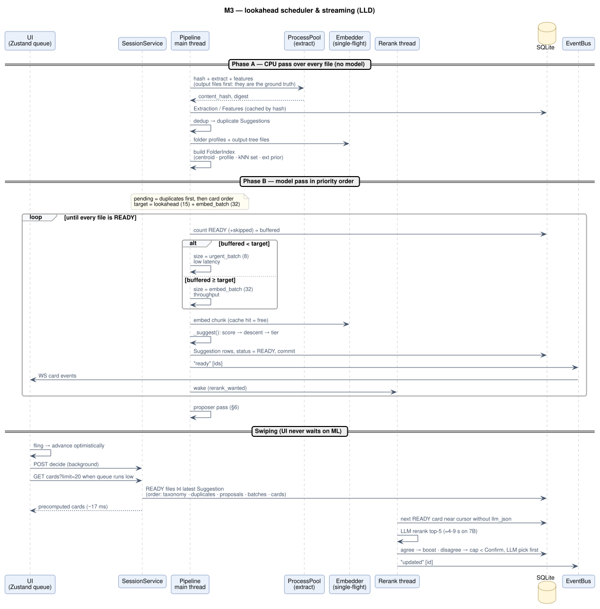
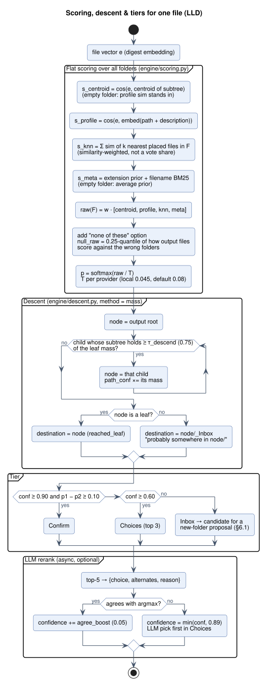
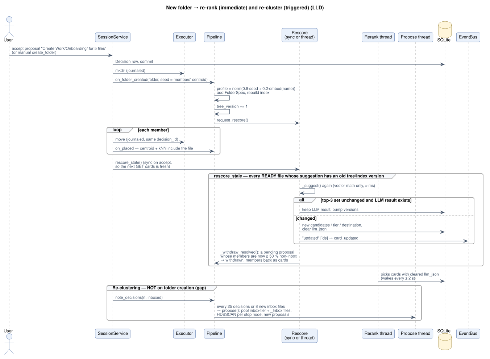
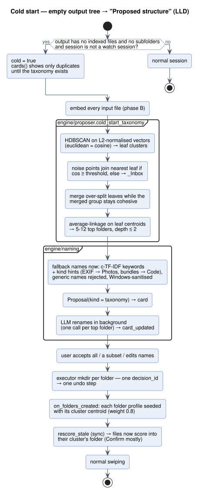
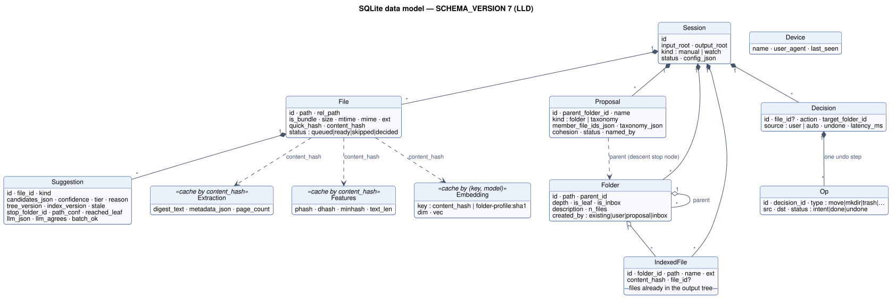
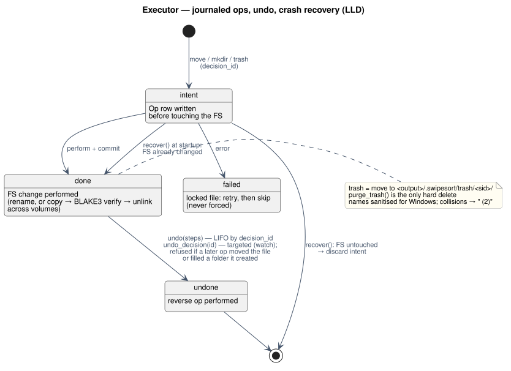
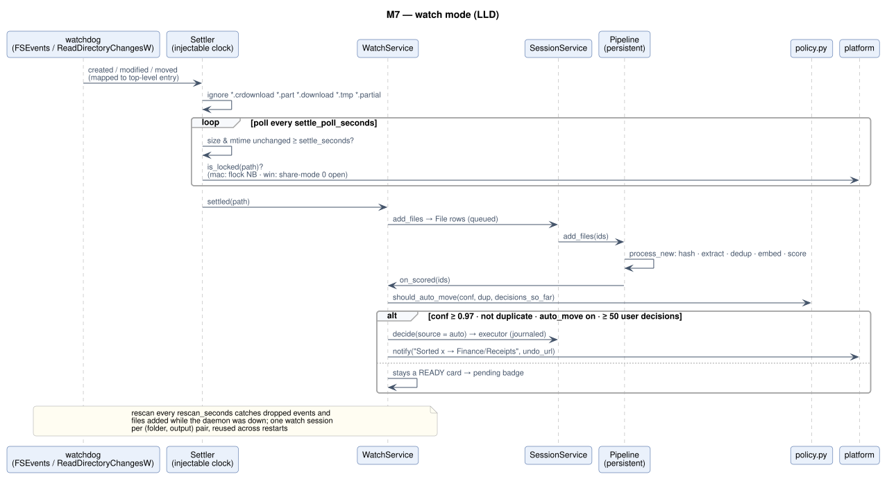
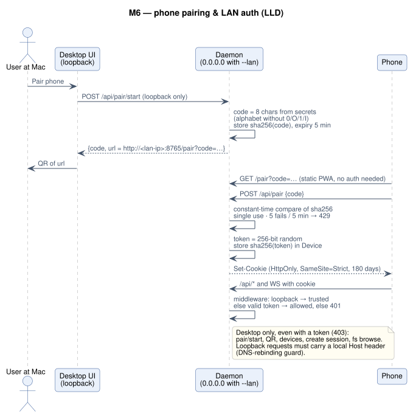
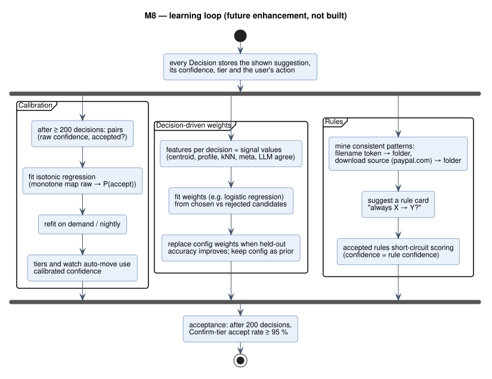

# SwipeSort — Low-Level Design

Every number below is a default from `config.py`; none is hard-coded.

## 1. M3 lookahead scheduler

**Goal:** keep at least 15 READY cards ahead of the user, show the first card within seconds, and still finish the whole session quickly.

1. **Phase A, no model.** Hash, extract and compute dedup features for every file in a process pool. Output-tree files are processed first, because they are what inputs get scored against. Dedup runs here, so duplicate cards are known before any embedding.
2. **Folder index.** Embed the folder profiles (path + description) and the files already in the output tree. Build the per-folder data: centroid, profile, kNN set and extension prior.
3. **Phase B, priority order.** Duplicates come first, then files in card order (the order the user will see them).
4. **Lookahead-aware batch size.**
   - `buffered` = number of READY files; `target` = `lookahead + embed_batch` (15 + 32).
   - While `buffered < target`, embed `urgent_batch` (8) files at a time, which gives low latency.
   - Above the target, embed `embed_batch` (32) at a time, which gives throughput.
   - Measured on 1k files: first card at 6.9 s with the real model; the buffer stays ≥ 16 at 4 cards/s.
5. **Streaming.** Each chunk commits its Suggestions, emits `ready`, and wakes the rerank thread. The UI receives the cards over the WebSocket.
6. **Swiping.**
   - The UI advances optimistically: the decide POST runs in the background.
   - The only request the UI can wait on is `GET cards`, which joins READY files with their latest Suggestion (about 17 ms).
7. **Invalidation.** Every Suggestion stores `tree_version` and `index_version`.

   | Event | Effect |
   |---|---|
   | Folder created or removed | `tree_version++` |
   | Every 25 moves into one folder (`index_bump_every`) | `index_version++` |
   | Each single move | Updates that folder's centroid and kNN set right away, without a rescore |

   A version bump triggers `rescore_stale()`. The LLM result is kept when the set of the top 3 folders is unchanged.

## 2. Scoring, descent & tiers

- **Signals.** Four signals are computed per folder and combined by weights from config:
  - centroid similarity,
  - profile similarity,
  - kNN similarity (the sum of similarities, not a vote share),
  - metadata (extension prior + filename BM25).

  An empty folder gets neutral evidence: profile similarity stands in for the centroid, and it gets the average extension prior. This lets a new folder win.
- **Null option.** A "none of these" option is added before the softmax. Its score is the 0.25-quantile of how existing output files score against the wrong folders. Without it the softmax is purely relative, so a file that fits nothing would still get Confirm.
- **Temperature.** Set per embedding provider, because each model has a different similarity scale (bge-small 0.045).
- **Descent, `method = mass`.** Step into a child folder while its subtree holds at least 0.75 of the leaf probability mass. Otherwise stop at `<node>/_Inbox`. It beat the original centroid-step method on the nested corpus; that method is still selectable.
- **Tiers.**

  | Tier | Condition |
  |---|---|
  | Confirm | conf ≥ 0.90 and margin p1 − p2 ≥ 0.10 |
  | Choices | conf ≥ 0.60 |
  | Inbox | anything below 0.60 |
- **LLM rerank.**
  - Agreement adds 0.05 to the confidence.
  - Disagreement caps confidence at 0.89 (below Confirm) and puts the LLM's pick first in the choices.
  - It also resolves ambiguous mid-tree stops.

## 3. New folder → re-rank and re-cluster

**Re-ranking happens immediately:**
1. `on_folder_created(folder, seed)` embeds the folder name. For a folder accepted from a proposal, it mixes in the members' centroid: `profile = norm(0.8·seed + 0.2·name)`.
2. It then bumps `tree_version` and requests a rescore.
3. Accepting a proposal runs `rescore_stale()` synchronously, so the next `GET cards` already points into the new folder.
4. Each moved member also passes through `on_placed`, which adds it to the folder's centroid and kNN set.
5. Changed cards get `card_updated`. Cards whose top 3 changed lose their LLM result, and the rerank thread redoes them.
6. `_withdraw_resolved()` withdraws any pending proposal whose members are now mostly confident (≥ 50% outside the Inbox tier). Those members come back as normal cards.

**Re-clustering runs right after that rescore.** A folder creation sets a flag, and the rescore that follows calls `request_proposals()`. Files that still don't fit anywhere are re-clustered immediately. The proposer also re-runs:
- every 25 decisions (`every_decisions`), and
- after 8 files have been sent to an `_Inbox` (`inbox_trigger`).

Each run pools inbox-tier READY files plus files already sitting in `_Inbox` folders, then clusters them with HDBSCAN per descent stop node. Groups that were dismissed earlier are never proposed again. Undoing a folder withdraws any pending proposal created under it.

## 4. Cold start

1. **Detection.** The output tree has no indexed files and no subfolders, and the session isn't a watch session. While the taxonomy is pending, only duplicate cards are shown.
2. **Clustering** (`proposer.cold_start_taxonomy`):
   - HDBSCAN on L2-normalised vectors.
   - Noise points join their nearest cluster if close enough, otherwise go to `_Inbox`.
   - Over-split clusters are merged while the merged group stays cohesive.
   - Average-linkage on cluster centroids builds 5–12 top folders, at most 2 levels deep.
3. **Naming.**
   - A keyword fallback names folders immediately: c-TF-IDF keywords, plus kind hints such as EXIF → Photos.
   - Generic names are rejected, and names are sanitized for Windows.
   - The LLM renames in the background with one call per top folder.
4. **Accept.** The user accepts all, a subset, or edited names. One `mkdir` per folder, all under one decision (one undo step). Each folder's profile is seeded with its cluster centroid, then `rescore_stale()` runs. On the 300-file eval this gave 290 Confirm, 2 Choices and 8 Inbox.

## 5. Data model

- **Caches** (`Extraction`, `Features`, `Embedding`) are keyed by content hash or by (key, model). They survive across sessions.
- **Schema changes.** A schema mismatch moves the old DB aside as `.v<N>.bak`; it is never deleted.

## 6. Executor, journal & undo

- **Moves.** A move is a rename on the same volume. Across volumes it is copy → BLAKE3 verify → unlink.
- **Collisions.** A name collision gets ` (2)` appended. An identical file is treated as a dedup case instead.
- **Session undo** runs LIFO per decision, so a batch or a proposal is one undo step.
- **Targeted undo** (watch mode) is refused when a later op moved the file again, or put something into a folder this decision created.
- **Crash recovery.** `recover()` at startup finishes or discards ops left in `intent`.

## 7. Watch mode

1. A watched file is processed once it is **settled**:
   - size and mtime have been stable for `settle_seconds`, **and**
   - the file can be opened exclusively, **and**
   - its name doesn't match a partial-download pattern.
2. The file goes through the incremental pipeline (`process_new`).
3. **Auto-move** requires all four: conf ≥ 0.97, not a duplicate, `auto_move` on, and ≥ 50 user decisions.

   Anything else stays as a pending card.
4. Auto-moves are normal decisions with `source = auto`.

## 8. Pairing & LAN auth

- **The pairing code is proof of presence.** Only a loopback client can mint one; it's single-use and lasts 5 minutes.
- **The device token is the credential.** It's 256 bits, only its hash is stored, it can be revoked, and it travels as an HttpOnly cookie.

## 9. M8 learning (future enhancement)

Each Decision already records the suggestion shown, its tier, the action taken and the latency. M8 uses that history in three ways:
- **Calibration.** Isotonic regression maps raw confidence to the observed accept rate, refit after ≥ 200 decisions. Tiers and the auto-move threshold then use calibrated confidence.
- **Learned weights.** Fit the signal weights from chosen vs rejected candidates. The config weights stay as the prior and fallback.
- **Rules.** Mine consistent patterns, such as a filename token → folder or a download source → folder, and offer them as "always X → Y?" cards. An accepted rule bypasses scoring.

Acceptance: after 200 decisions, the Confirm-tier accept rate is ≥ 95%.
